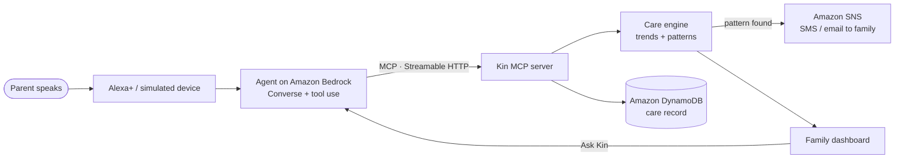

# Kin

**An Alexa+ care companion for parents who live alone.**

Amazon retired Alexa Together, its caregiving service, in 2024. The need didn't go away: millions of older adults live alone while their children live in another city or another country. Kin brings that back as an Alexa+ integration built on MCP.

The parent just talks to Alexa the way they already do:

> "I took my sugar tablet." · "Felt dizzy again when I got up." · "Feeling a bit low, the house is very quiet."

Kin logs it, remembers it across days, and notices what no single conversation can see. For example: *dizziness reported three times this week, each time on or right after a day the blood-pressure tablet was missed.* When a pattern like that shows up, Kin tells the family on its own, explains why, and gently tells the parent it has done so.

## What's in this repo

| Piece | What it does |
| --- | --- |
| **Kin MCP server** (`src/mcp`) | MCP server on Streamable HTTP, protocol `2025-11-25`. Tools for logging medication, symptoms, mood, sleep and notes; reading trends; notifying family; scheduling spoken reminders; and a family briefing. All state is persisted, so it works across sessions and devices. |
| **Care engine** (`src/care`) | Turns two weeks of logs into findings: medication adherence, recurring symptoms, mood and sleep drift, red-flag symptoms, and cross-signal patterns (symptoms that line up with missed doses). Escalates to family automatically, at most once per pattern every 12 hours. The engine is deterministic: the model explains and acts on findings, it never invents them. |
| **Voice agent** (`src/agent`) | Amazon Bedrock (Converse API with tool use) acting as the Alexa+ side. It connects to the Kin MCP server as an MCP client, the same way Alexa+ would. |
| **Simulated Alexa+ device** (`public/index.html`) | Voice in and voice out in the browser, with a live "behind the scenes" panel showing every MCP tool call. Speaks scheduled reminders on its own. |
| **Family dashboard** (`public/family.html`) | Care level, what Kin noticed and why, the alerts sent, a 14-day medication/symptom/mood timeline, mood and sleep trends, an AI-written daily digest, and "Ask Kin" for questions like "How has Mum been sleeping?". |

## Architecture



The parent's device and the family's questions go through the **same MCP server**. Mum talks to her Echo; her daughter asks her own Alexa, "How's Mum doing?", and gets an answer from the same care record.

### MCP tools

| Tool | Purpose |
| --- | --- |
| `get_care_context` | Who the person is, what's due today, the last 24h, upcoming reminders, current care level |
| `log_medication` / `log_symptom` / `log_mood` / `log_sleep` / `log_note` | Record what the person said (verbatim words kept for the family). Each call re-evaluates the care picture and may notify the family. |
| `get_trends` | Two-week adherence, symptom counts, mood/sleep series, findings |
| `notify_family` | Agent-initiated message to the family (for example, an emergency) |
| `schedule_reminder` | A reminder Kin speaks later |
| `get_family_briefing` | Summary for family members asking how their parent is |

Resources: `kin://household/profile`, `kin://household/insights`.

## Run it locally

Requires Node 20+.

```bash
npm install
cp .env.example .env      # set KIN_LLM=mock to run without AWS
npm start
```

- Parent device (simulated Alexa+): http://localhost:3000 (use Chrome or Edge for voice)
- Family dashboard: http://localhost:3000/family.html
- MCP endpoint: http://localhost:3000/mcp

On first start the server loads a demo household: Kamala, 74, in Pune, with two weeks of history. Over the last four days her BP tablet has been missed twice, dizziness has appeared twice, and her mood and sleep have slipped. Say *"I'm feeling dizzy again"* and Kin completes the pattern and alerts her daughter. **Reset demo** on the dashboard reloads the history.

To inspect the MCP server with any MCP client:

```bash
npm run inspect          # then connect to http://localhost:3000/mcp (Streamable HTTP)
```

## Run it on AWS

1. **Bedrock:** enable model access for the model in `KIN_MODEL_ID` (default `us.amazon.nova-pro-v1:0`; any Converse model with tool use works) and set `KIN_LLM=bedrock`.
2. **DynamoDB:** create a table with partition key `pk` (String) and sort key `sk` (String), then set `KIN_TABLE`.
   ```bash
   aws dynamodb create-table --table-name kin --attribute-definitions AttributeName=pk,AttributeType=S AttributeName=sk,AttributeType=S --key-schema AttributeName=pk,KeyType=HASH AttributeName=sk,KeyType=RANGE --billing-mode PAY_PER_REQUEST
   ```
3. **SNS:** create a topic, subscribe the family's email or phone number, then set `KIN_SNS_TOPIC_ARN`.
   ```bash
   aws sns create-topic --name kin-family
   aws sns subscribe --topic-arn <arn> --protocol email --notification-endpoint <family email>
   ```
4. **Seed:** `npm run seed`
5. **Host:** the included `Dockerfile` runs on AWS App Runner or ECS. Set `KIN_MCP_TOKEN` so `/mcp` requires a bearer token once it is public. IAM needs `bedrock:InvokeModel`, `dynamodb:GetItem/PutItem/Query/BatchWriteItem` on the table, and `sns:Publish` on the topic.

## Design choices

- **Voice first for the parent, visual for the family.** Older adults won't install an app, but they will talk to the speaker in the kitchen. Adult children want the "why", not raw data.
- **Patterns, not pings.** One dizzy spell isn't an alert. Dizziness that keeps lining up with missed blood-pressure doses is.
- **Calm escalation.** One alert per pattern per 12 hours. Red-flag phrases (chest pain, a fall, trouble breathing) escalate immediately, and the parent is told to call emergency services.
- **No diagnosis.** Kin reports what was said and what it noticed, and suggests calling or checking with the doctor.
- **Their own words.** The family sees what their parent actually said, not just a score.

## License

MIT
